# Mes outils : guide d'utilisation

**Français** · [English](GUIDE.en.md)

Mes outils est un tableau de bord personnel pour Windows, pensé pour les
développeurs. Une petite bulle flotte sur l'écran ; un clic ouvre vos projets,
vos serveurs de dev, GitHub, vos mails, notes, agenda, mots de passe et une
boîte à outils. Tout tourne sur votre PC, sans compte ni service en ligne.

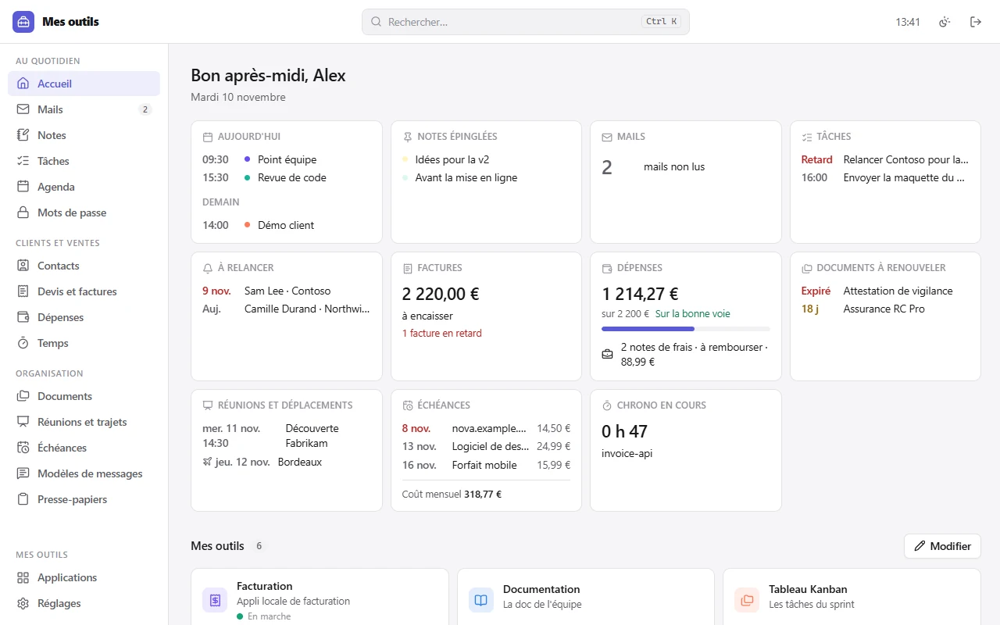

## Sommaire

- [Installation](#installation)
- [La bulle](#la-bulle)
- [Se déplacer](#se-déplacer)
- Les onglets : [Accueil](#accueil) · [Serveurs](#serveurs) · [Projets](#projets) · [GitHub](#github) ·
  [Ports](#ports) · [Docker](#docker) · [Testeur d'API](#testeur-dapi) ·
  [SSH](#ssh) · [Mails](#mails) · [Notes](#notes) · [Agenda](#agenda) ·
  [Mots de passe](#mots-de-passe) · [Boîte à outils](#boîte-à-outils) ·
  [Extraits](#extraits) · [Presse-papiers](#presse-papiers) ·
  [Temps](#temps) · [Réglages](#réglages)
- [Sécurité et vie privée](#sécurité-et-vie-privée)
- [Questions fréquentes](#questions-fréquentes)
- [Ajouter un onglet](#ajouter-un-onglet)

## Installation

### Le plus simple : l'installateur (rien d'autre à installer)

1. Téléchargez **[Mes-outils-Setup.exe](https://github.com/rarianaAina/mes-outils/releases/latest/download/Mes-outils-Setup.exe)** (environ 17 Mo, Windows 10
   ou 11).
2. Lancez-le. Windows peut afficher « Windows a protégé votre ordinateur » :
   l'installateur n'est pas signé (c'est payant). Cliquez sur
   **Informations complémentaires**, puis **Exécuter quand même**.
3. Choisissez les options (raccourci sur le Bureau, démarrage avec Windows),
   puis **Installer**. La bulle apparaît.

Pas besoin de droits administrateur ni de Python : tout est inclus. Le
programme s'installe dans `%LOCALAPPDATA%\Programs\Mes outils` ; vos
réglages et vos données sont dans `%APPDATA%\Mes outils` et restent sur votre
PC (ils sont gardés lors des mises à jour et même après une désinstallation).
Désinstaller : Paramètres de Windows › Applications › Mes outils.

> Git n'est utile que pour les fonctions Git (état des projets, clonage). Sans
> Git, tout le reste marche.

### Pour les développeurs : depuis le code source

Il faut Python 3.10 ou plus récent (avec tkinter) et Git.

```bat
git clone https://github.com/rarianaAina/mes-outils.git
cd mes-outils
installer.bat
```

`installer.bat` vérifie Python, installe les bibliothèques
(`requirements.txt`), crée les raccourcis et lance la bulle. Les données sont
alors à côté du code (`outils.json`, `donnees\`), jamais envoyées sur GitHub.
Si vous passez ensuite à l'installateur, vos réglages et données sont repris
automatiquement au premier lancement (ils sont copiés, l'original reste).

## La bulle

Une bulle violette flotte au-dessus des autres fenêtres, sans bouton dans la
barre des tâches. Elle démarre avec Windows.

| Geste | Effet |
|---|---|
| **Clic** | ouvre le tableau de bord (ou le ramène devant s'il est déjà ouvert) |
| **Glisser** | déplace la bulle ; elle revient au même endroit la fois suivante |
| **Clic droit** | accès direct : note rapide, mails, agenda, notes, mots de passe, projets, GitHub, serveurs locaux (démarrer, arrêter, ouvrir), chrono, extraits, presse-papiers, vos outils, « Masquer 15 minutes », « Quitter la bulle » |

Les pastilles autour de la bulle :

- **verte** (en haut à droite) : nombre de serveurs de dev en marche ;
- **corail** (en haut à gauche) : nombre de mails non lus ;
- **rouge** (en bas) : tests GitHub Actions en échec.

Au repos, la bulle est un peu transparente ; elle redevient pleine quand la
souris passe dessus. À l'heure d'un rappel (note, rendez-vous, Pomodoro), une
carte apparaît à côté d'elle avec un son.

Le tableau de bord s'ouvre dans une fenêtre Edge sans barre d'adresse. Le
fermer ne coupe rien : la bulle reste là. Si vous avez quitté la bulle,
relancez-la avec le raccourci « Mes outils » du Bureau.

## Se déplacer

- **Menu à gauche** : les onglets sont rangés en trois groupes, « Au
  quotidien », « Développement » et « Petits outils ».
- **Ctrl + K** (ou « Rechercher… » en haut) : la palette de commandes. Tapez
  quelques lettres pour aller à un onglet, lancer un de vos outils ou changer
  de thème, puis Entrée.
- **Thème** : clair, sombre ou automatique (comme Windows).
- **Langue** : français ou anglais, dans les Réglages.

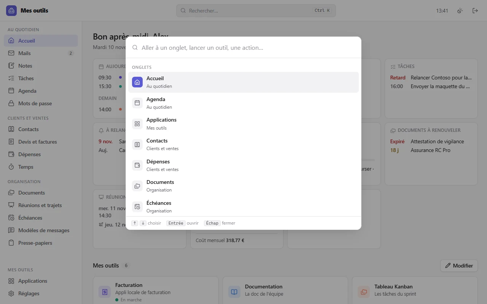

Le même tableau de bord en thème sombre :

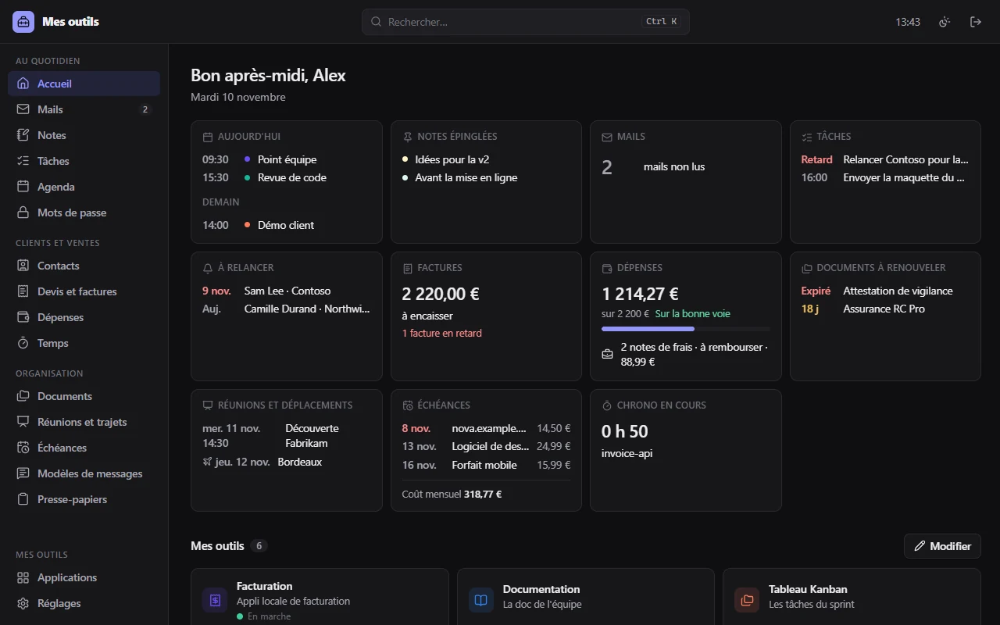

## Les onglets

### Accueil

La page d'arrivée (voir la capture en haut de ce guide).

- **Aujourd'hui** : vos rendez-vous du jour et du lendemain.
- **Notes épinglées**, **mails non lus**, **chrono en cours**.
- **Code** : projets à envoyer, modifiés, en retard, tests GitHub en échec.
- **Mes outils** : vos tuiles (dossier, fichier, programme, page web ou appli
  locale). « Modifier » pour en ajouter, modifier ou retirer.

### Serveurs

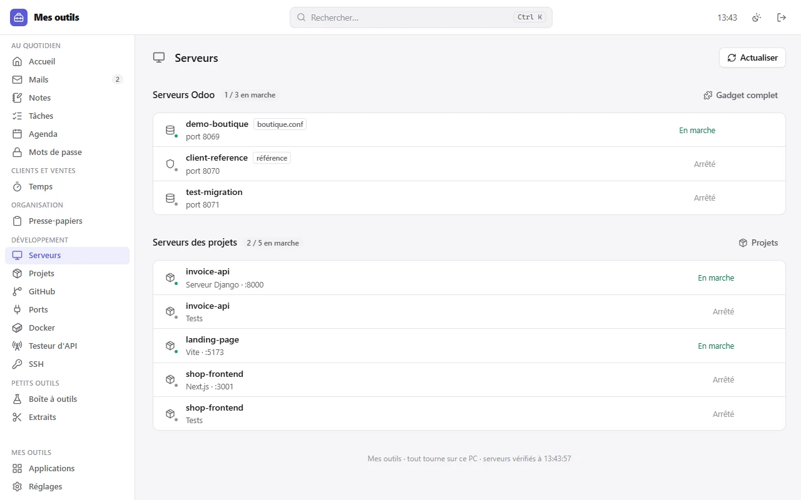

Tous vos serveurs au même endroit : les serveurs de dev de vos projets (les
commandes définies dans Projets) et, si vous l'utilisez, les serveurs Odoo
d'un gadget externe (`gestion_serveurs.py`, chemin dans `outils.json`, clé
`serveurs_odoo` › `gadget`).

- démarrer, arrêter, ↗ ouvrir dans le navigateur, journal ;
- pastille verte = en marche, orange = démarrage, rouge = port pris par un
  autre programme ;
- une base Odoo marquée « référence » demande une confirmation avant d'être
  démarrée.

### Projets

Les projets trouvés dans vos dossiers de projets, avec leur type (Node,
Next.js, Vite, Python, Django, Docker, Odoo…).

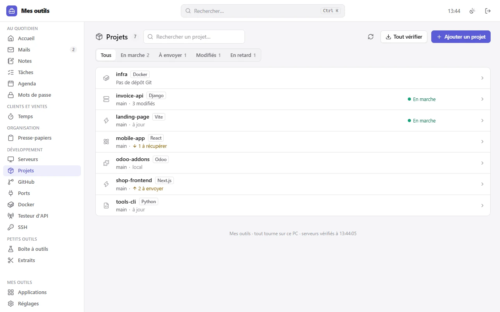

- Ouvrir un projet en un clic : **Dossier**, **VS Code**, **Terminal**.
- Voir l'**état Git** : à envoyer, à récupérer, modifié ; « Tout
  vérifier » fait un `git fetch` de tous les projets.
- Configurer les **commandes de dev** () : l'outil en propose d'après le
  projet (`npm run dev`, `manage.py runserver`, `docker compose up`…).
- **Démarrer** et **Arrêter** un serveur de dev, **** ouvrir le site,
  **** lire son journal en direct.
- Sauvegarder les fichiers **.env** dans le coffre chiffré () et les
  restaurer en un clic.

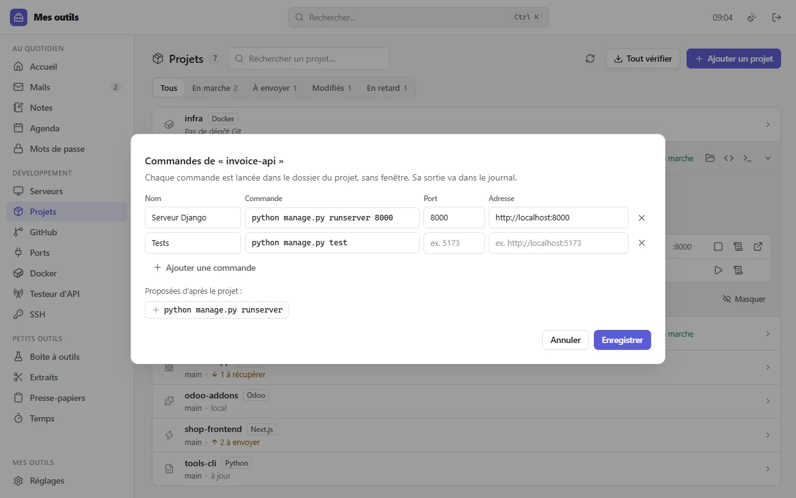

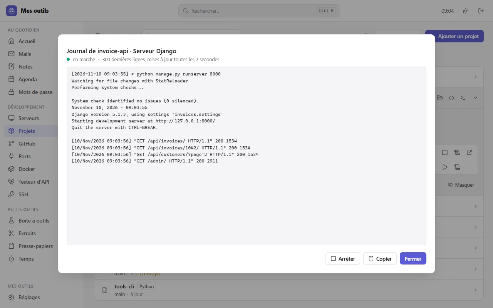

### GitHub

Tous vos dépôts (publics, privés, ceux de vos organisations). La connexion se
fait une seule fois avec un code à valider sur github.com, sans mot de passe.

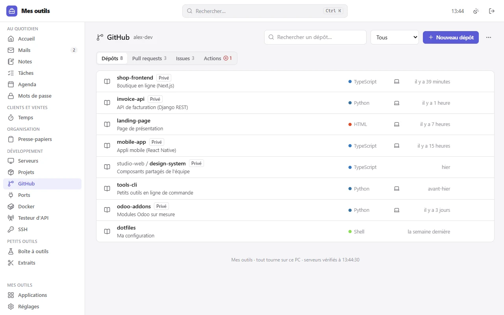

- Chercher et filtrer vos dépôts (privés, publics, sur ce PC ou non).
- **Cloner** un dépôt, ou l'ouvrir dans son dossier ou dans VS Code s'il est
  déjà sur ce PC.
- **+ Nouveau dépôt** à partir d'un dossier : le contenu est vérifié avant
  l'envoi (`.gitignore` respecté, fichiers sensibles comme `.env` signalés,
  fichiers de plus de 100 Mo refusés).
- **Pull requests** : les vôtres et celles où votre relecture est demandée.
- **Issues** qui vous sont assignées.
- **Actions** : l'état des derniers tests de vos dépôts ; un échec allume la
  pastille rouge de la bulle.

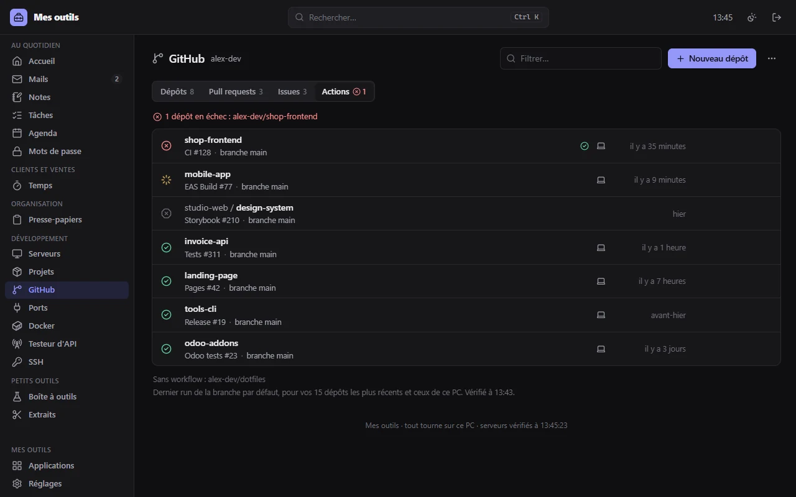

### Ports

Quel programme occupe le port 3000 ? La réponse en un coup d'œil.

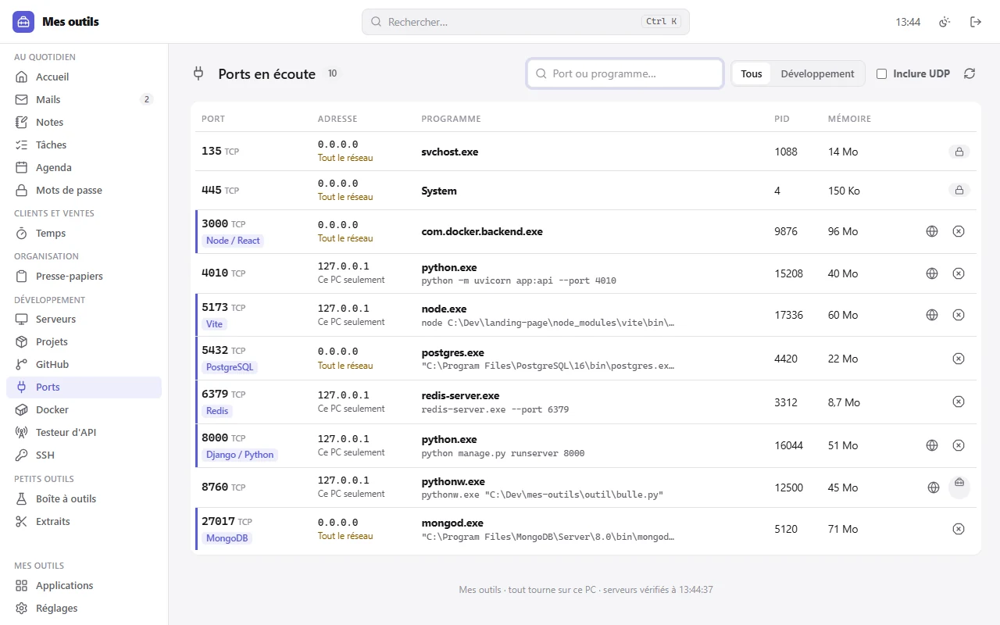

- Voir tous les ports en écoute, avec le programme, sa ligne de commande et sa
  mémoire.
- Chercher un port ou un programme ; filtre « Développement ».
- Ouvrir un port web dans le navigateur ().
- **Arrêter** un programme après confirmation. Les processus système et Mes
  outils lui-même sont protégés ().

### Docker

Vos conteneurs, groupés par projet compose.

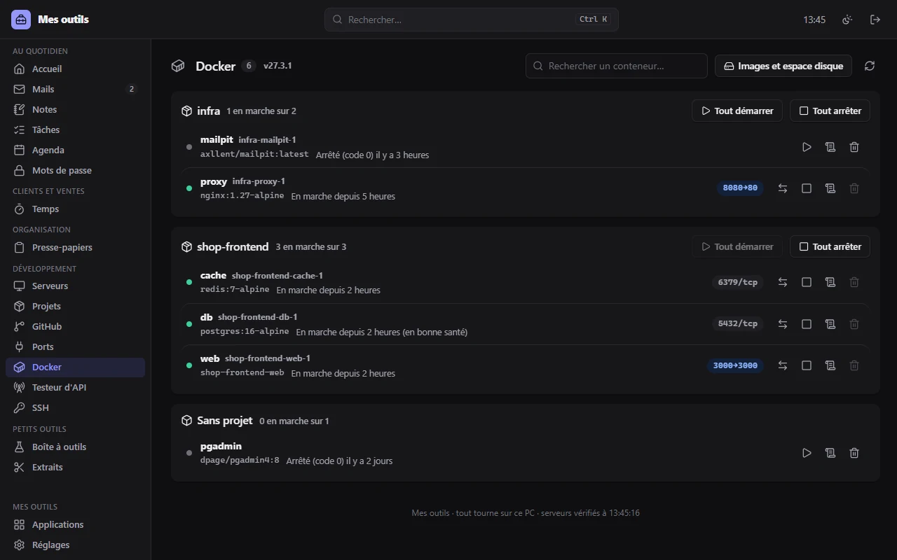

- Démarrer, arrêter, redémarrer ou supprimer un conteneur.
- « Tout démarrer » ou « Tout arrêter » pour un projet compose entier.
- Lire le journal d'un conteneur.
- Ouvrir les ports publiés en un clic.
- « Images et espace disque » : la place occupée par Docker.

### Testeur d'API

Un mini Postman, directement dans le tableau de bord.

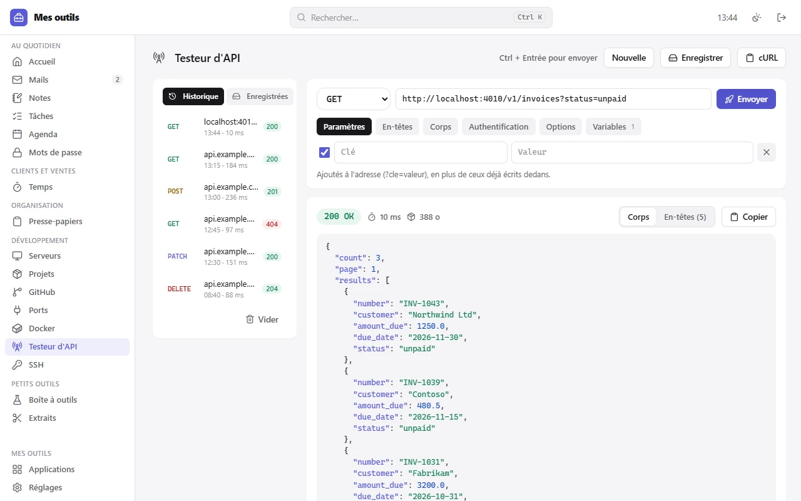

- Choisir la méthode, l'adresse, les paramètres, en-têtes, corps (JSON, texte,
  formulaire) et l'authentification (Bearer, Basic).
- Lire la réponse mise en forme, avec son statut, sa durée et ses en-têtes.
- Utiliser des **variables** (`{{base_url}}`).
- Retrouver l'**historique** (les secrets n'y sont jamais enregistrés) et vos
  requêtes enregistrées.
- Copier une requête en commande **cURL**.

### SSH

Une clé par serveur, posée en un clic.

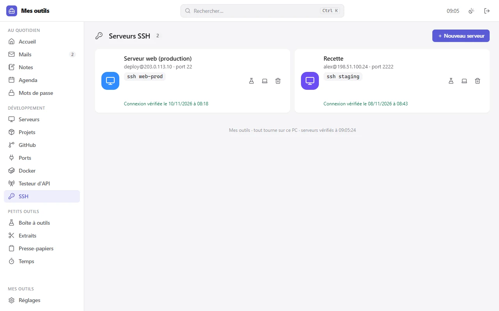

- « + Nouveau serveur » : nom, adresse, port, identifiant et mot de passe.
  L'outil crée la clé, la dépose sur le serveur, puis vérifie la connexion.
- Le mot de passe ne sert qu'à cette fois : il n'est enregistré nulle part.
- Ensuite, dans un terminal : `ssh <nom-court>` (clic sur la carte = copie).
- tester la connexion, ouvrir un terminal sur le serveur, retirer la
  clé du serveur puis de ce PC.

### Mails

Votre boîte mail : Gmail, Yahoo, iCloud, Zoho, Fastmail, GMX, OVH, Orange,
Free, La Poste ou tout serveur IMAP/SMTP.

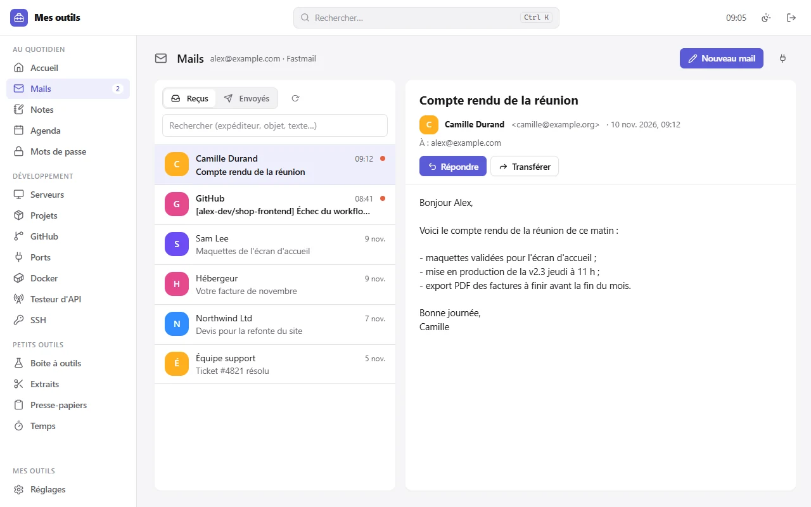

- Lire les mails reçus et envoyés, chercher.
- Répondre, transférer, écrire un nouveau mail.
- Les images distantes sont bloquées (elles servent à savoir si vous avez lu
  le mail) : bouton « Afficher les images ».
- Le guide du fournisseur s'affiche à la première connexion ; le mot de passe
  est rangé dans le coffre de Windows. pour se déconnecter.

### Notes

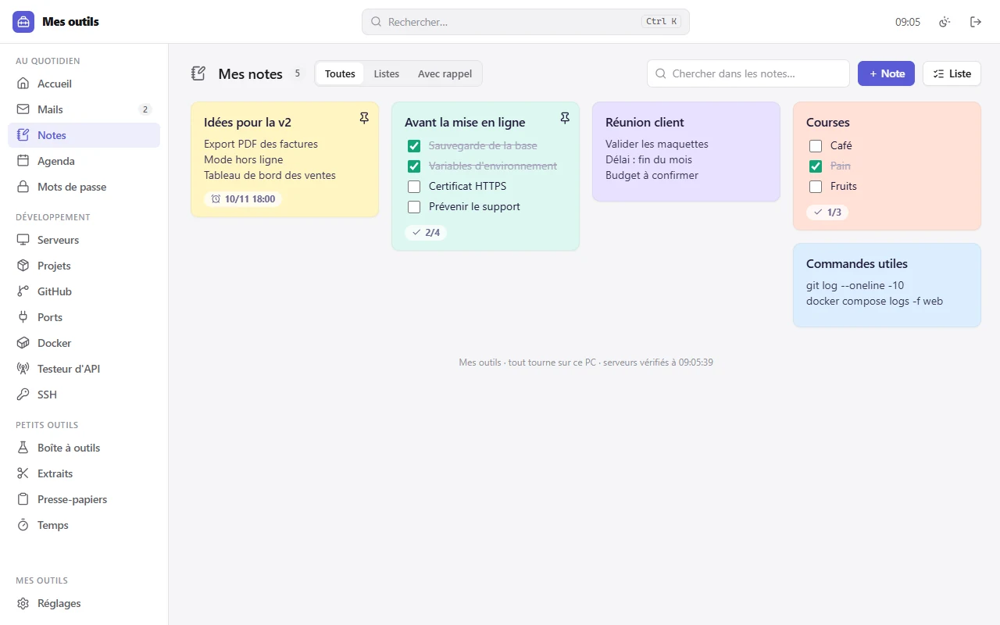

- Notes en cartes colorées ou **listes à cocher**.
- **Épingler** une note (elle apparaît sur l'Accueil).
- **Rappel** à une date et une heure : la bulle vous prévient.
- Recherche et filtres (listes, avec rappel).
- Enregistrement automatique pendant la frappe.

### Agenda

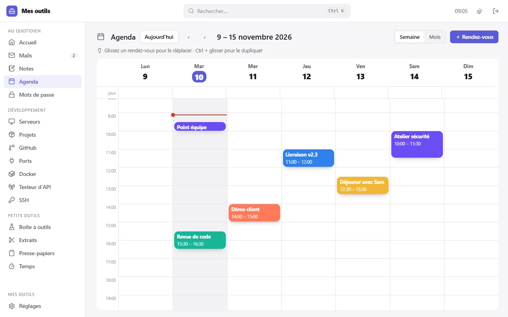

- Vue **semaine** et vue **mois**.
- Cliquer sur un créneau pour créer un rendez-vous.
- **Glisser** un rendez-vous pour le déplacer ; **Ctrl + glisser** pour le
  dupliquer.
- Rappel par la bulle : à l'heure, 5, 15, 30 minutes ou 1 heure avant, ou la
  veille.

### Mots de passe

Un coffre chiffré, ouvert avec un mot de passe maître.

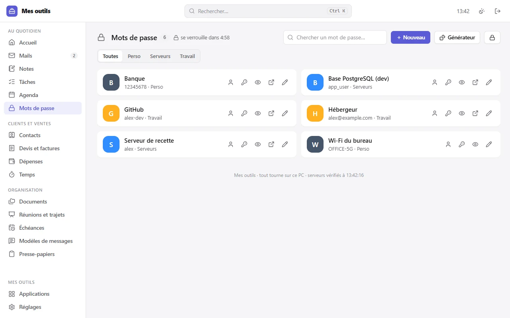

- Ranger vos identifiants par catégorie, avec une note chiffrée.
- **Copier** un mot de passe : il est effacé du presse-papiers après
  30 secondes et n'entre pas dans l'historique Windows (Win + V).
- **Afficher** un mot de passe pendant 15 secondes.
- **Générateur** de mots de passe solides.
- Le coffre se verrouille seul après 5 minutes sans utilisation (ou ).

> Le mot de passe maître n'est enregistré nulle part : s'il est oublié, le
> coffre est perdu. Notez-le sur papier.

### Boîte à outils

Les petits outils de tous les jours. Rien ne quitte la page.

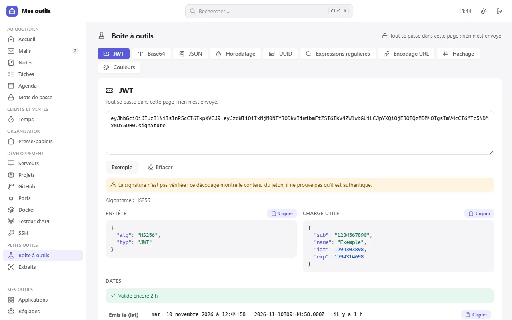

- **JWT** : lire l'en-tête, le contenu et les dates d'un jeton.
- **Base64**, **JSON** (mise en forme, tri), **encodage URL**.
- **Horodatage** Unix ↔ date, **UUID**.
- **Expressions régulières** testées en direct.
- **Hachage** (SHA) d'un texte ou d'un fichier, **couleurs**.

### Extraits

Vos commandes et bouts de code favoris.

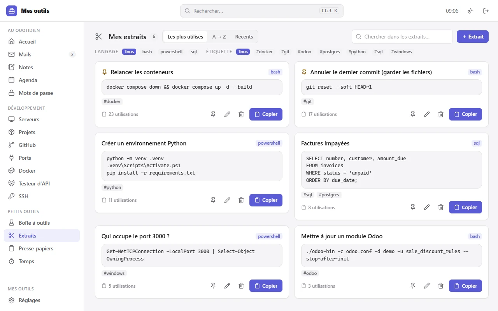

- Un clic sur **Copier** : l'extrait est dans le presse-papiers.
- Classer par langage et par étiquette, épingler les plus utiles.
- Trier par usage, par titre ou par date.
- Aussi disponibles depuis le clic droit sur la bulle.

### Presse-papiers

Les 50 derniers textes copiés.

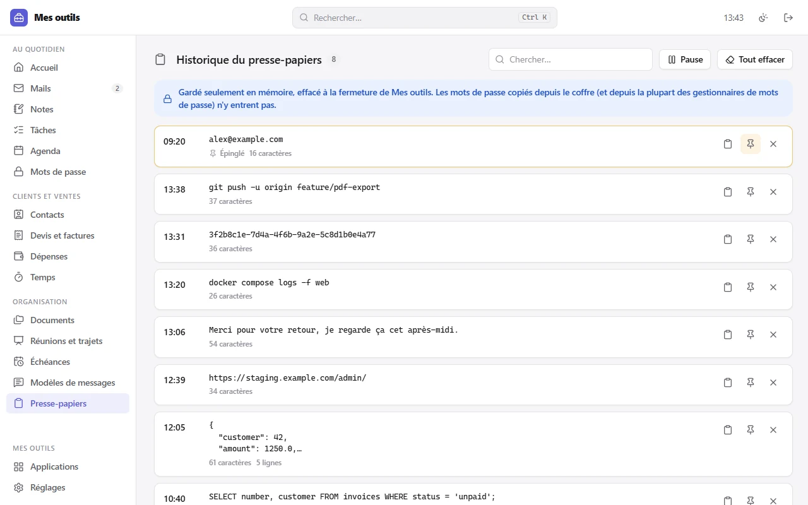

- Recopier un ancien texte en un clic.
- Épingler les textes à garder sous la main.
- Chercher dans l'historique.
- **Pause** pour ne plus rien enregistrer un moment.
- L'historique est gardé **en mémoire seulement** et effacé à la fermeture ;
  les mots de passe copiés depuis le coffre n'y entrent pas.

### Temps

Le temps passé sur chaque projet.

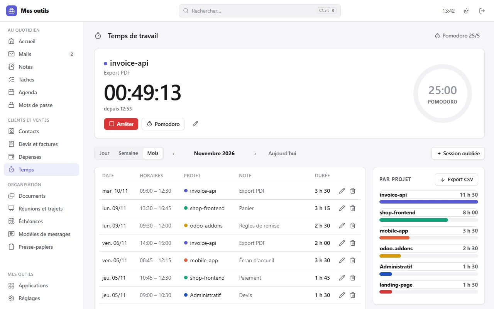

- **Chrono** par projet (un seul à la fois), avec une note.
- **Pomodoro** : la bulle prévient à la fin de chaque période.
- Sessions par jour, semaine ou mois, totaux par projet.
- Ajouter une **session oubliée**, modifier ou supprimer une session.
- **Export CSV** pour Excel et la facturation.

### Réglages

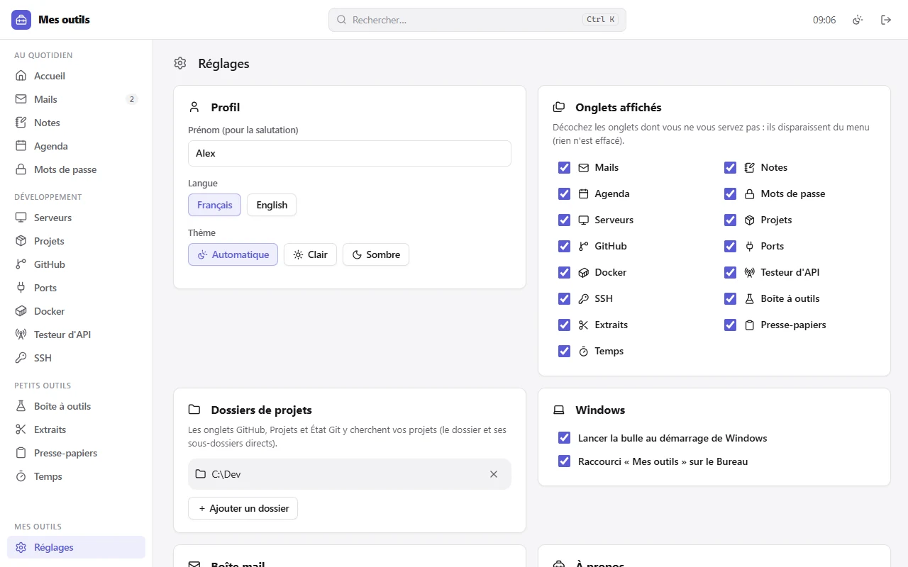

- Prénom (pour la salutation), **langue** (français, anglais), **thème**.
- **Onglets affichés** : décochez ceux dont vous ne vous servez pas.
- **Dossiers de projets** : là où les onglets Projets et GitHub cherchent vos
  projets.
- Démarrage avec Windows, raccourci sur le Bureau.
- **À propos** : « Rechercher une mise à jour ».

## Sécurité et vie privée

- **Tout reste sur votre PC.** Le serveur du tableau de bord n'écoute que sur
  `127.0.0.1` (ce PC seulement). Aucun compte, aucun service en ligne, aucune
  statistique envoyée.
- **Le serveur refuse les ordres venant d'autres sites** : une page web ouverte
  dans votre navigateur ne peut pas lui parler.
- **Coffre à mots de passe chiffré** en AES-256-GCM ; la clé est tirée du mot
  de passe maître par scrypt. Le mot de passe maître n'est enregistré nulle
  part.
- **Jeton GitHub et mots de passe des mails** rangés dans le coffre de Windows
  (Gestionnaire d'identification), jamais dans un fichier en clair.
- **Presse-papiers** : l'historique reste en mémoire, il n'est jamais écrit sur
  le disque.
- **Testeur d'API** : les jetons et mots de passe sont masqués dans
  l'historique.
- **SSH** : le mot de passe du serveur ne sert qu'à déposer la clé ; il n'est
  pas enregistré.

## Questions fréquentes

**Outlook ou Hotmail ne se connectent pas.**
Ils ne sont pas encore pris en charge : Microsoft exige une autre méthode de
connexion. Les autres fournisseurs (Gmail, Yahoo, iCloud…) fonctionnent avec
un mot de passe d'application ou le mot de passe habituel, selon le guide
affiché.

**L'onglet Docker dit que Docker est absent.**
Installez Docker Desktop et démarrez-le ; l'onglet propose de le télécharger ou de le lancer.
Sans Docker, le reste de l'outil fonctionne normalement.

**Comment mettre à jour Mes outils ?**
Réglages › À propos › « Rechercher une mise à jour ». Avec l'installateur,
cliquez sur **Installer** : la nouvelle version se télécharge, s'installe et
Mes outils redémarre tout seul (vos réglages et données sont gardés). Avec une
installation faite avec `git clone`, la mise à jour fait un `git pull` ;
relancez ensuite la bulle (clic droit › « Quitter la bulle », puis le
raccourci).

**La bulle a disparu.**
Elle est peut-être masquée pour 15 minutes, ou vous l'avez quittée : relancez
le raccourci « Mes outils » du Bureau.

**Mes projets n'apparaissent pas.**
Ajoutez leur dossier dans Réglages › Dossiers de projets. L'outil regarde ce
dossier et ses sous-dossiers directs ; un projet ailleurs s'ajoute avec
« + Ajouter un projet ».

**Un serveur de dev ne s'arrête pas.**
« Arrêter » n'arrête que ce que Mes outils a lancé. Pour un autre
programme, passez par l'onglet Ports.

**Où sont mes données ?**
Dans le dossier de Mes outils : `outils.json` (réglages et tuiles) et
`donnees\` (notes, agenda, coffre chiffré…). Pensez à les sauvegarder.

## Ajouter un onglet

Un onglet = un fichier Python et un fichier JavaScript, sans toucher au reste.
Tout est expliqué dans [MODULES.md](MODULES.md).

---

Anciennes versions de ce guide : [version 1.4](archives/v1.4/GUIDE.md) · [version 1.3](archives/v1.3/GUIDE.md).
