> **Older version of the guide** (Mes outils 1.4). Current guide: [docs/GUIDE.en.md](../../GUIDE.en.md).

# Mes outils: guide

[Français](GUIDE.md) · **English**

Mes outils ("my tools") is a personal dashboard for Windows, made for
developers. A small bubble floats on the screen; one click opens your
projects, dev servers, GitHub, mail, notes, calendar, passwords and a toolbox.
Everything runs on your PC, with no account and no online service.

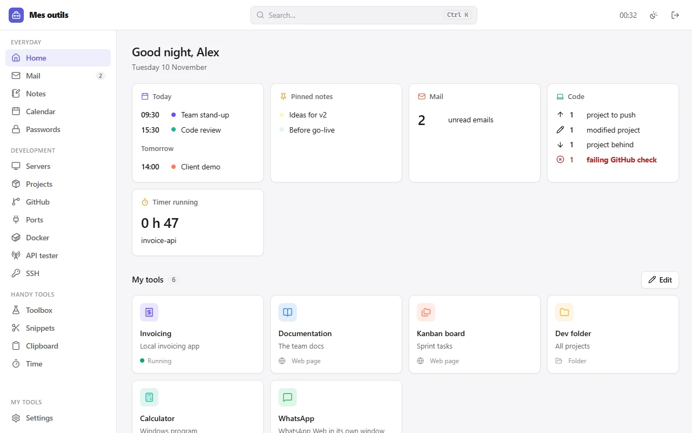

## Contents

- [Installation](#installation)
- [The bubble](#the-bubble)
- [Getting around](#getting-around)
- The tabs: [Home](#home) · [Servers](#servers) · [Projects](#projects) · [GitHub](#github) ·
  [Ports](#ports) · [Docker](#docker) · [API tester](#api-tester) ·
  [SSH](#ssh) · [Mail](#mail) · [Notes](#notes) · [Calendar](#calendar) ·
  [Passwords](#passwords) · [Toolbox](#toolbox) · [Snippets](#snippets) ·
  [Clipboard](#clipboard) · [Time](#time) · [Settings](#settings)
- [Security and privacy](#security-and-privacy)
- [FAQ](#faq)
- [Adding a tab](#adding-a-tab)

## Installation

### The easy way: the installer (nothing else to install)

1. Download **[Mes-outils-Setup.exe](https://github.com/rarianaAina/mes-outils/releases/latest/download/Mes-outils-Setup.exe)** (about 17 MB, Windows 10 or 11).
2. Run it. Windows may show "Windows protected your PC": the installer is not
   signed (signing costs money). Click **More info**, then **Run anyway**.
3. Pick the options (Desktop shortcut, start with Windows), then **Install**.
   The bubble appears.

No administrator rights and no Python needed: everything is included. The
program goes to `%LOCALAPPDATA%\Programs\Mes outils`; your settings and data
live in `%APPDATA%\Mes outils` and stay on your PC (kept across updates and
even after uninstalling). Uninstall: Windows Settings › Apps › Mes outils.

> Git is only needed for the Git features (project status, cloning). Without
> Git, everything else works.

### For developers: from the source code

You need Python 3.10 or later (with tkinter) and Git.

```bat
git clone https://github.com/rarianaAina/mes-outils.git
cd mes-outils
installer.bat
```

`installer.bat` checks Python, installs the libraries (`requirements.txt`),
creates the shortcuts and starts the bubble. Data then lives next to the code
(`outils.json`, `donnees\`), never sent to GitHub. If you later switch to the
installer, your settings and data are picked up automatically on first launch
(they are copied, the original stays).

## The bubble

A purple bubble floats above the other windows, with no taskbar button. It
starts with Windows.

| Action | Result |
|---|---|
| **Click** | opens the dashboard (or brings it to the front if already open) |
| **Drag** | moves the bubble; it comes back to the same place next time |
| **Right-click** | quick access: quick note, mail, calendar, notes, passwords, projects, GitHub, local servers (start, stop, open), timer, snippets, clipboard, your tools, "Hide for 15 minutes", "Quit the bubble" |

The badges around the bubble:

- **green** (top right): number of dev servers running;
- **coral** (top left): number of unread emails;
- **red** (bottom): failing GitHub Actions tests.

When idle, the bubble is slightly transparent; it becomes solid when the mouse
moves over it. When a reminder is due (note, appointment, Pomodoro), a card
pops up next to it with a sound.

The dashboard opens in an Edge window with no address bar. Closing it stops
nothing: the bubble stays. If you quit the bubble, start it again with the
"Mes outils" shortcut on the Desktop.

## Getting around

- **Left menu**: the tabs are sorted into three groups, "Everyday",
  "Development" and "Handy tools".
- **Ctrl + K** (or "Search…" at the top): the command palette. Type a few
  letters to go to a tab, launch one of your tools or switch theme, then
  press Enter.
- **Theme**: light, dark or automatic (follows Windows).
- **Language**: French or English, in the Settings.

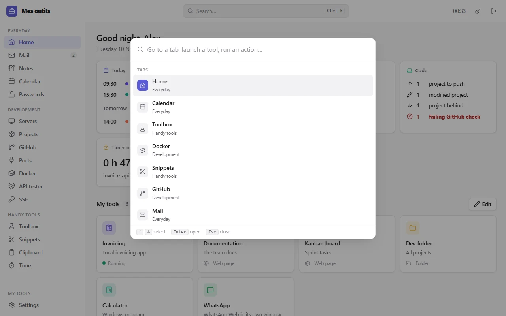

The same dashboard with the dark theme:

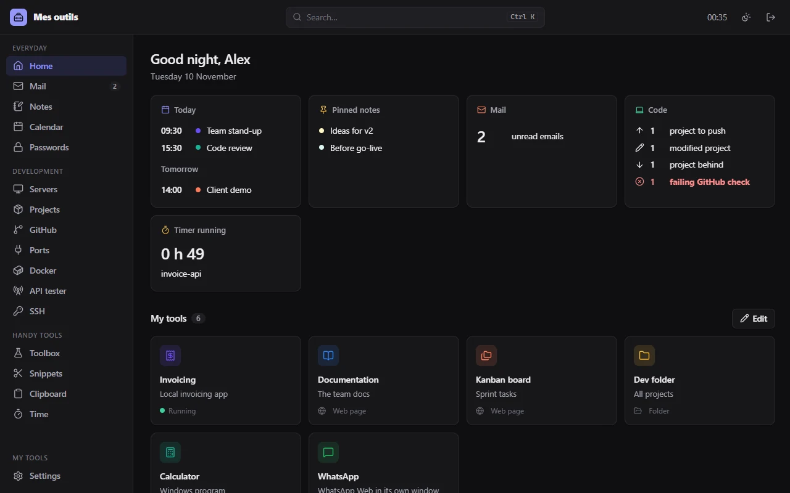

## The tabs

### Home

The landing page (see the screenshot at the top of this guide).

- **Today**: your appointments for today and tomorrow.
- **Pinned notes**, **unread emails**, **timer running**.
- **Code**: projects to push, modified, behind, failing GitHub tests.
- **My tools**: your tiles (folder, file, program, web page or local app).
  "Edit" to add, change or remove them.

### Servers

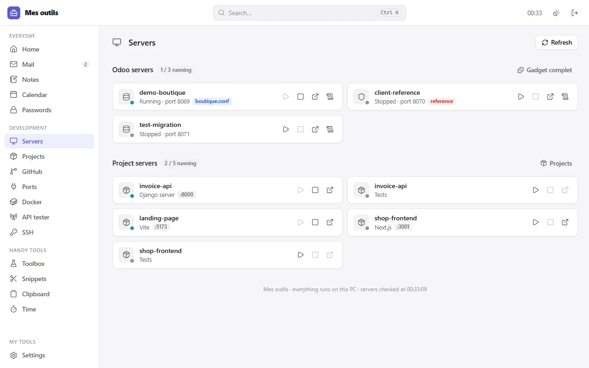

All your servers in one place: your projects' dev servers (the commands set
in Projects) and, if you use it, the Odoo servers of an external gadget
(`gestion_serveurs.py`, path in `outils.json`, key `serveurs_odoo` › `gadget`).

- start, stop, ↗ open in the browser, log;
- green dot = running, orange = starting, red = port taken by another
  program;
- an Odoo database marked "reference" asks for confirmation before starting.

### Projects

The projects found in your project folders, with their type (Node, Next.js,
Vite, Python, Django, Docker, Odoo…).

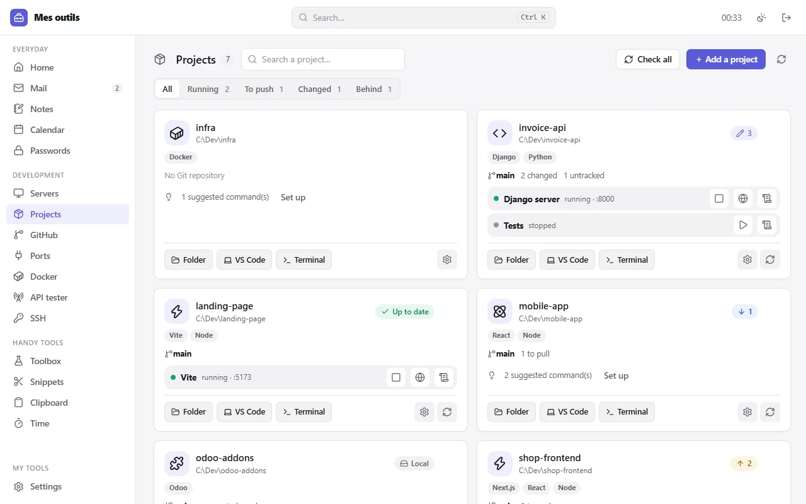

- Open a project in one click: **Folder**, **VS Code**, **Terminal**.
- See the **Git status**: to push, to pull, modified; "Check all"
  runs a `git fetch` on every project.
- Set up the **dev commands** (): the tool suggests some from the project
  (`npm run dev`, `manage.py runserver`, `docker compose up`…).
- **Start** and **Stop** a dev server, **** open the site, **** read
  its live log.
- Back up **.env** files to the encrypted vault () and restore them in one
  click.

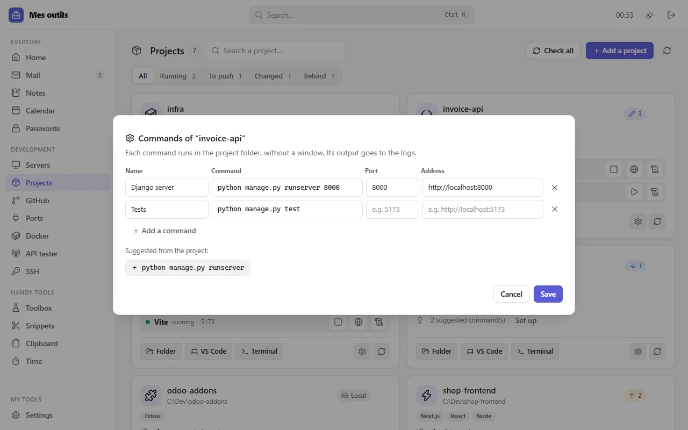

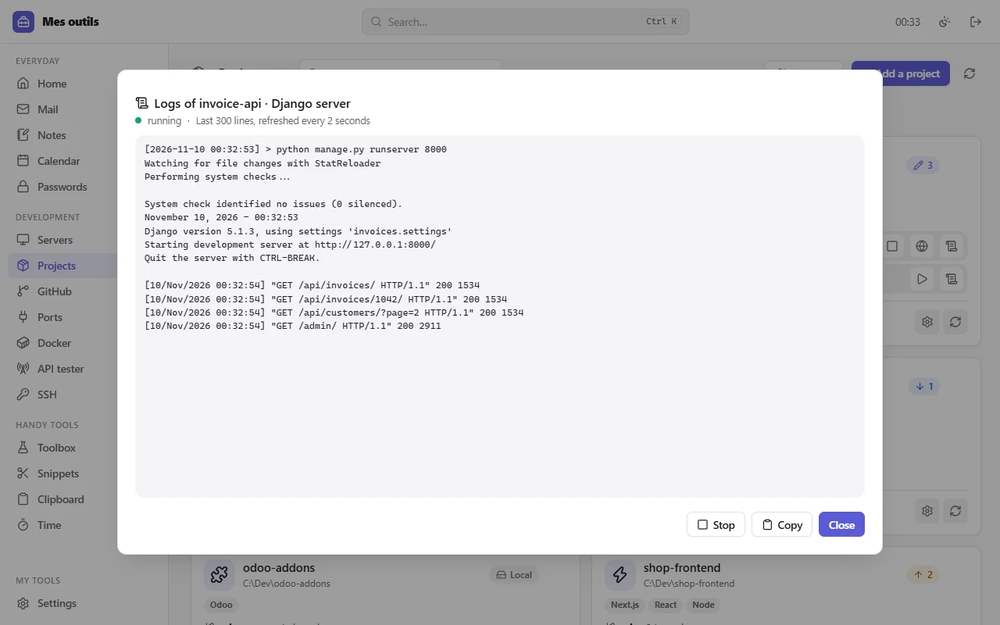

### GitHub

All your repositories (public, private, your organizations'). You sign in once
with a code to confirm on github.com, without a password.

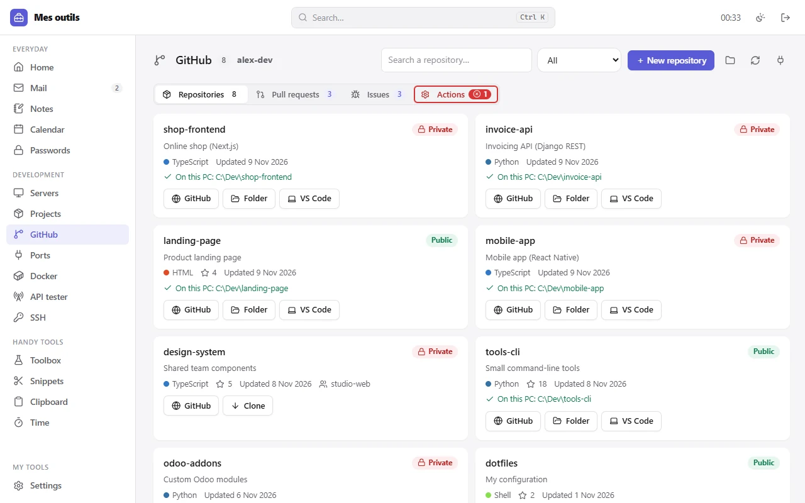

- Search and filter your repositories (private, public, on this PC or not).
- **Clone** a repository, or open its folder or VS Code if it is already on
  this PC.
- **+ New repository** from a folder: the content is checked before sending
  (`.gitignore` respected, sensitive files such as `.env` flagged, files over
  100 MB refused).
- **Pull requests**: yours and those waiting for your review.
- **Issues** assigned to you.
- **Actions**: the status of the latest runs of your repositories; a failure
  lights the bubble's red badge.

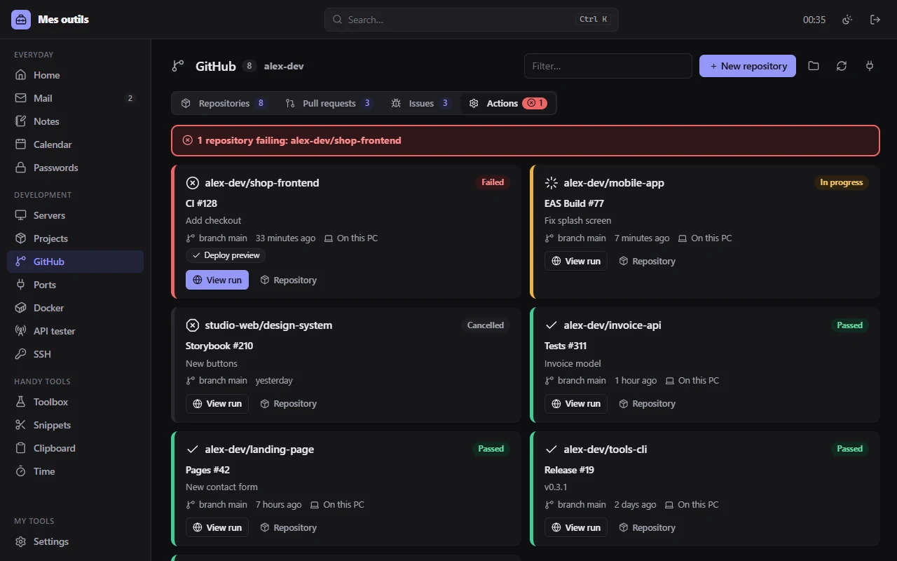

### Ports

Which program is using port 3000? The answer at a glance.

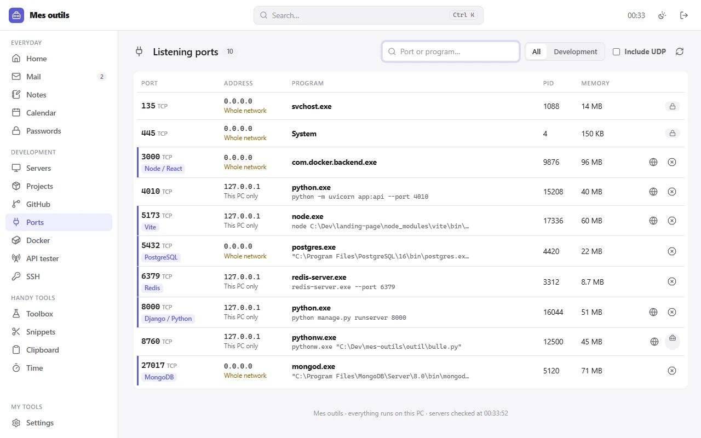

- See every listening port, with the program, its command line and its
  memory.
- Search for a port or a program; "Development" filter.
- Open a web port in the browser ().
- **Stop** a program after confirmation. System processes and Mes outils
  itself are protected ().

### Docker

Your containers, grouped by compose project.

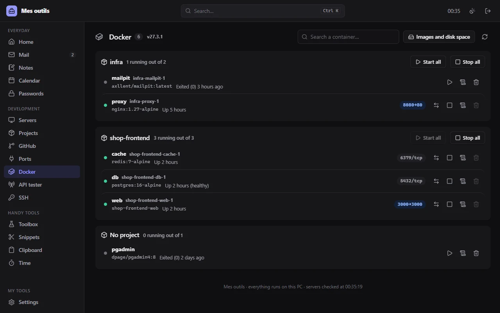

- Start, stop, restart or remove a container.
- "Start all" or "Stop all" for a whole compose project.
- Read a container's log.
- Open the published ports in one click.
- "Images and disk space": how much room Docker takes.

### API tester

A mini Postman, right in the dashboard.

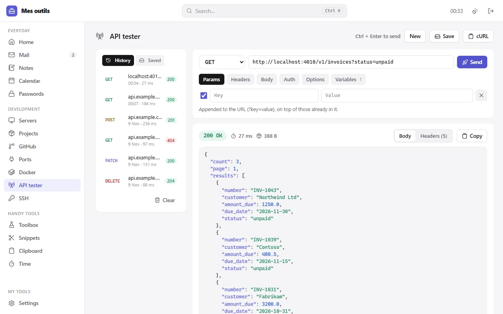

- Choose the method, URL, parameters, headers, body (JSON, text, form) and
  authentication (Bearer, Basic).
- Read the formatted response, with its status, duration and headers.
- Use **variables** (`{{base_url}}`).
- Find the **history** (secrets are never saved in it) and your saved
  requests.
- Copy a request as a **cURL** command.

### SSH

One key per server, set up in one click.

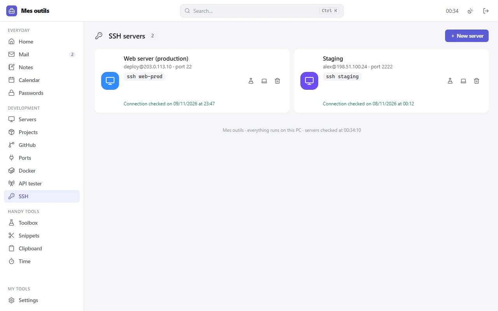

- "+ New server": name, address, port, login and password. The tool creates
  the key, installs it on the server, then checks the connection.
- The password is only used that once: it is not stored anywhere.
- Then, in a terminal: `ssh <short-name>` (click the card to copy it).
- test the connection, open a terminal on the server, remove the key
  from the server, then from this PC.

### Mail

Your mailbox: Gmail, Yahoo, iCloud, Zoho, Fastmail, GMX, OVH, Orange, Free,
La Poste or any IMAP/SMTP server.

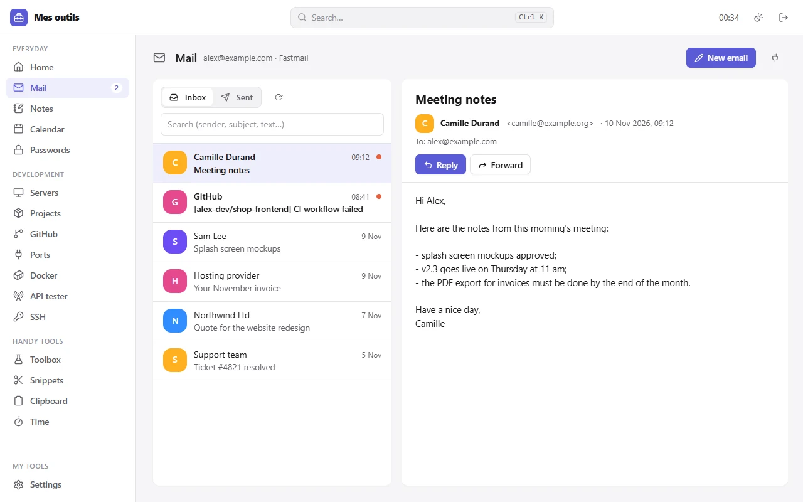

- Read received and sent emails, search.
- Reply, forward, write a new email.
- Remote images are blocked (they tell the sender you opened the email):
  "Show images" button.
- The provider's guide is shown the first time you connect; the password is
  stored in the Windows credential vault. to disconnect.

### Notes

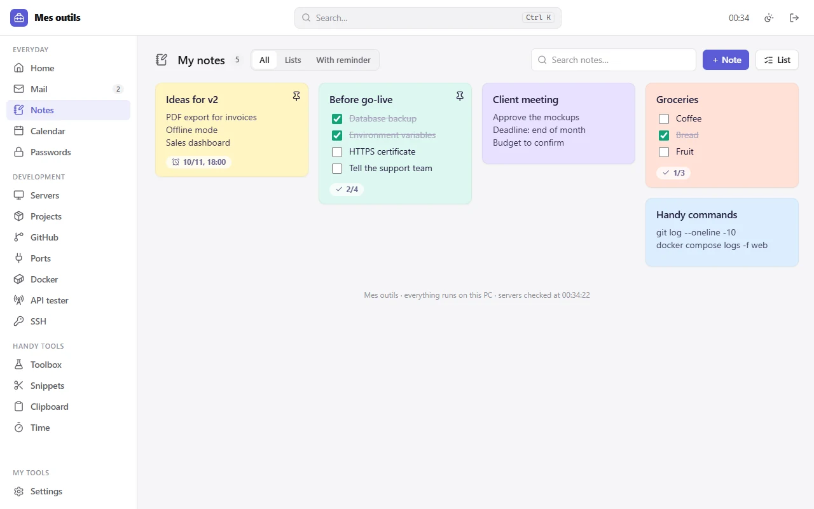

- Notes as colored cards or **checklists**.
- **Pin** a note (it shows on the Home page).
- **Reminder** at a date and time: the bubble lets you know.
- Search and filters (lists, with a reminder).
- Saved automatically as you type.

### Calendar

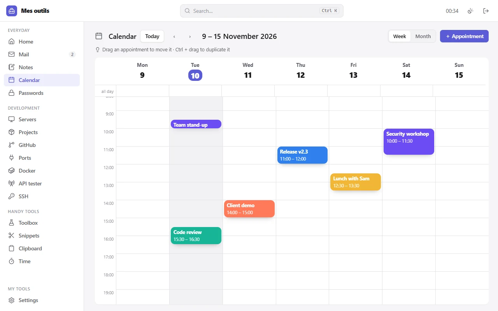

- **Week** and **month** views.
- Click a time slot to create an appointment.
- **Drag** an appointment to move it; **Ctrl + drag** to duplicate it.
- Reminder from the bubble: on time, 5, 15, 30 minutes or 1 hour before, or
  the day before.

### Passwords

An encrypted vault, opened with a master password.

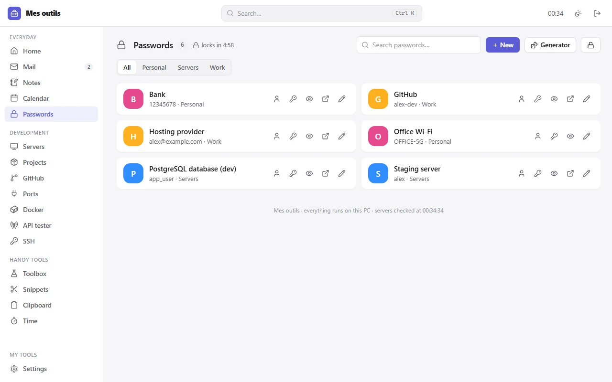

- Store your logins by category, with an encrypted note.
- **Copy** a password: it is cleared from the clipboard after 30 seconds and
  does not go into the Windows clipboard history (Win + V).
- **Show** a password for 15 seconds.
- **Generator** for strong passwords.
- The vault locks itself after 5 minutes of inactivity (or ).

> The master password is not stored anywhere: if you forget it, the vault
> is lost. Write it down on paper.

### Toolbox

Everyday small tools. Nothing leaves the page.

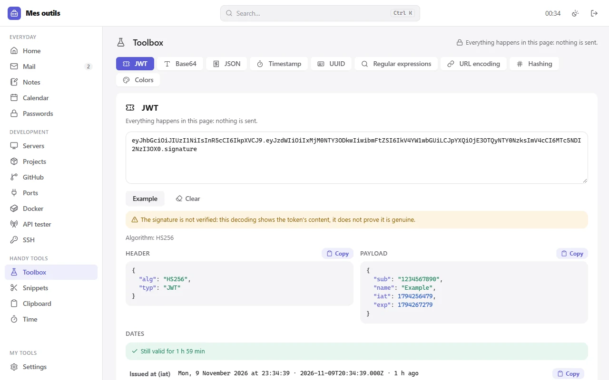

- **JWT**: read a token's header, payload and dates.
- **Base64**, **JSON** (formatting, sorting), **URL encoding**.
- Unix **timestamp** ↔ date, **UUID**.
- **Regular expressions** tested live.
- **Hashing** (SHA) of a text or a file, **colors**.

### Snippets

Your favorite commands and pieces of code.

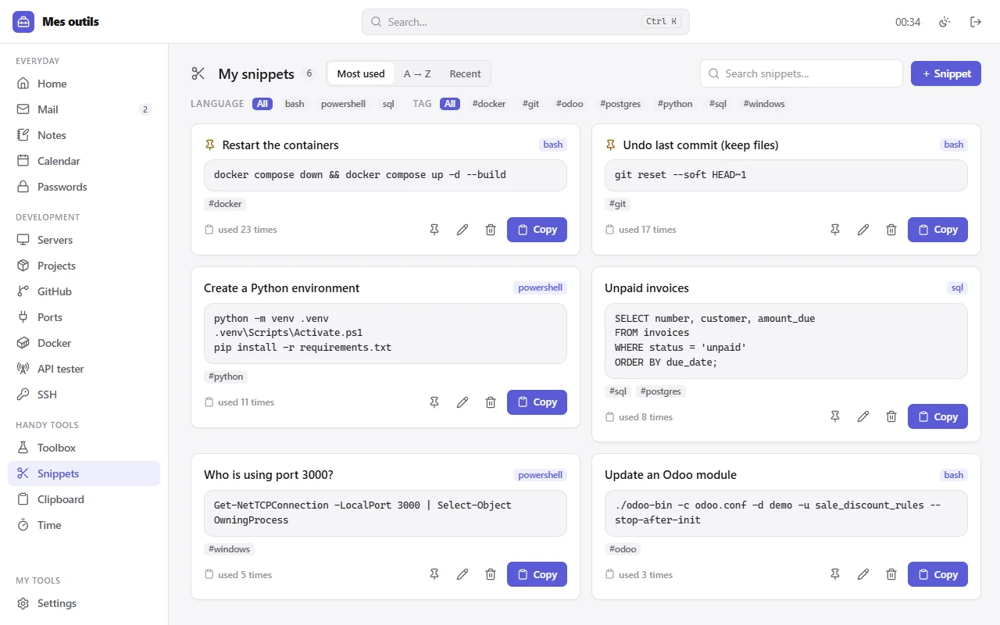

- One click on **Copy**: the snippet is in the clipboard.
- Sort them by language and tag, pin the most useful ones.
- Order by use, by title or by date.
- Also available from the bubble's right-click menu.

### Clipboard

The last 50 texts you copied.

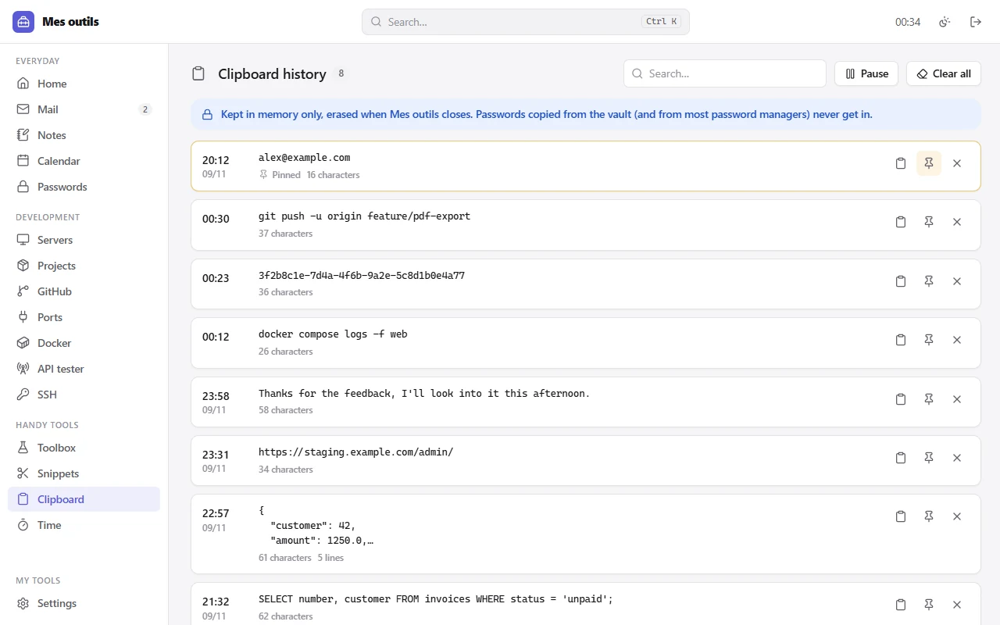

- Copy an older text again in one click.
- Pin the texts you want to keep at hand.
- Search the history.
- **Pause** to stop recording for a while.
- The history is kept **in memory only** and cleared when the app closes;
  passwords copied from the vault never go into it.

### Time

The time spent on each project.

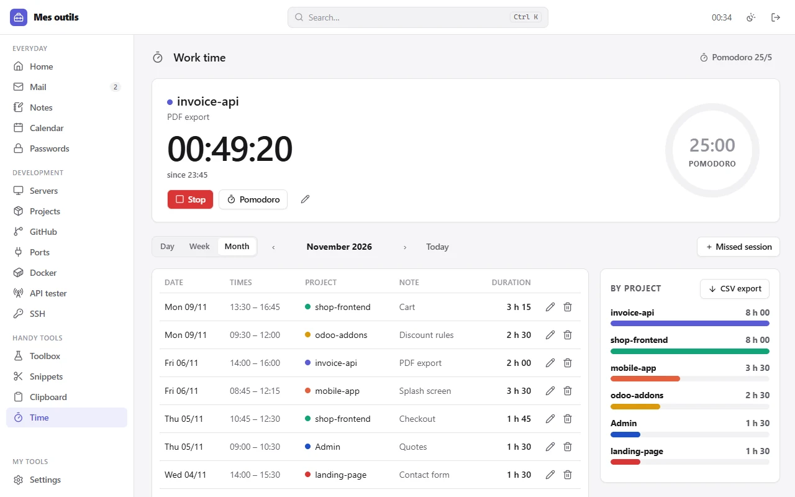

- **Timer** per project (one at a time), with a note.
- **Pomodoro**: the bubble lets you know at the end of each period.
- Sessions by day, week or month, totals per project.
- Add a **missed session**, edit or delete a session.
- **CSV export** for Excel and invoicing.

### Settings

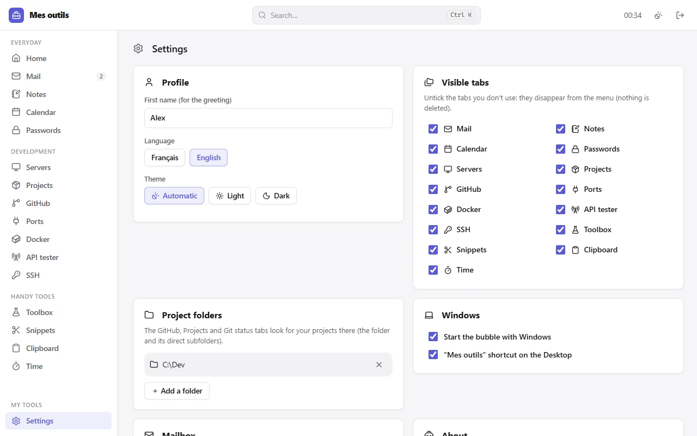

- First name (for the greeting), **language** (French, English), **theme**.
- **Visible tabs**: untick the ones you do not use.
- **Project folders**: where the Projects and GitHub tabs look for your
  projects.
- Start with Windows, Desktop shortcut.
- **About**: "Check for updates".

## Security and privacy

- **Everything stays on your PC.** The dashboard server only listens on
  `127.0.0.1` (this PC only). No account, no online service, no statistics
  sent.
- **The server refuses orders coming from other sites**: a web page open in
  your browser cannot talk to it.
- **Password vault encrypted** with AES-256-GCM; the key is derived from the
  master password with scrypt. The master password is not stored anywhere.
- **GitHub token and mail passwords** are kept in the Windows credential vault
  (Credential Manager), never in a plain-text file.
- **Clipboard**: the history stays in memory; it is never written to disk.
- **API tester**: tokens and passwords are masked in the history.
- **SSH**: the server password is only used to install the key; it is not
  stored.

## FAQ

**Outlook or Hotmail will not connect.**
They are not supported yet: Microsoft requires a different sign-in method. The
other providers (Gmail, Yahoo, iCloud…) work with an app password or the usual
password, as explained by the guide on screen.

**The Docker tab says Docker is missing.**
Install Docker Desktop and start it; the tab offers to download it or start
it. Without Docker, the rest of the tool works normally.

**How do I update Mes outils?**
Settings › About › "Check for updates". With the installer, click
**Install**: the new version downloads, installs and Mes outils restarts by
itself (your settings and data are kept). When installed with `git clone`, the
update runs `git pull`; then restart the bubble (right-click › "Quit the
bubble", then the shortcut).

**The bubble has disappeared.**
It may be hidden for 15 minutes, or you quit it: start the "Mes outils"
shortcut on the Desktop again.

**My projects do not show up.**
Add their folder in Settings › Project folders. The tool looks in that folder
and its direct subfolders; a project elsewhere can be added with
"+ Add a project".

**A dev server will not stop.**
"Stop" only stops what Mes outils started. For another program, use the
Ports tab.

**Where is my data?**
In the Mes outils folder: `outils.json` (settings and tiles) and `donnees\`
(notes, calendar, encrypted vault…). Remember to back them up.

## Adding a tab

A tab = one Python file and one JavaScript file, without touching the rest.
Everything is explained in [MODULES.md](MODULES.md) (in French).

---

Older versions of this guide: [version 1.3](../v1.3/GUIDE.en.md).
